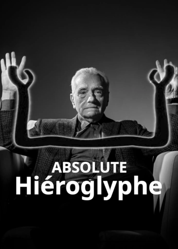

# Absolute_Hieroglyphe

## Compte Rendus

- Semaine 1: [CR1](rendus/s1/Projet%20Hiéroglyphe.pdf)
- Semaine 3: [CR2](rendus/s3/CR2.pdf)
- Semaine 4: [CR3](rendus/s4/CR3.pdf)
- Semaine 5: [CR4](rendus/s5/cr4.pdf)
    - Oral 1: [Présentation](rendus/s5/Présentation%20avancement%20-%20oral%201.pdf)
- Semaine 6: [CR5](rendus/s6/cr5.pdf)
- Semaine 7: [CR6](rendus/s6/cr6.pdf)

## Installation

Installez uv (ou utilisez un IDE compatible) : `curl -LsSf https://astral.sh/uv/install.sh | sh`

Configurez l'environnement Python : `uv sync`

## Exécution

Exécutez avec `uv run python src/absolute_hieroglyphe/main.py`

---

