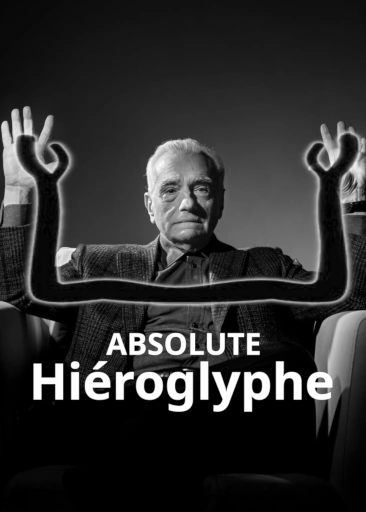

# Absolute_Hieroglyphe

### Comptes Rendus

Les rendus sont dans `rendus/sx` (avec x la semaine)

### Installation

Créez un environnement virtuel Python `python -m venv .venv/`

Installez les dépendances avec `./.venv/bin/python -m pip install -r requirements.txt`

Exécutez avec `./.venv/bin/python -m main.py`

---

